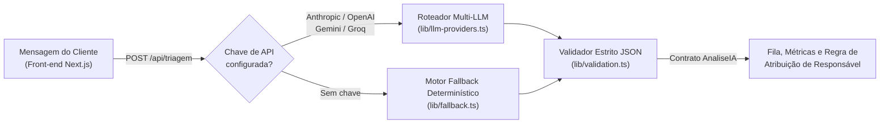

<div align="center">

# Triagem Inteligente — Plataforma de Suporte e Atendimento com IA

**Classificação automatizada de chamados, análise de sentimento, priorização por SLA/urgência e geração de respostas contextualizadas com suporte Multi-LLM (Anthropic Claude, OpenAI, Google Gemini e Groq).**

[](https://triagem-inteligente-ticia.vercel.app)


</div>

---

## Visão Geral e Problema de Negócio

Equipes de suporte ao cliente lidam diariamente com altos volumes de mensagens vindas de múltiplos canais (`WhatsApp`, `E-mail`, `Chat`, `Instagram` e `Telefone`). A triagem manual gera gargalos operacionais: **chamados críticos de cancelamento ou indisponibilidade técnica demoram a ser identificados**, enquanto solicitações rotineiras consomem tempo valioso dos analistas.

O **Triagem Inteligente** automatiza esse fluxo aplicando Inteligência Artificial Generativa para processar cada mensagem recebida e entregar em segundos:
1. **Categorização estruturada** e **nível de urgência** com justificativa em uma frase.
2. **Detecção de sentimento** com alerta automático (**`! Definir o Responsável`**) para atribuição imediata de casos críticos (`Urgência Alta` + `Sentimento Negativo`).
3. **Sugestão de resposta editável**, alinhada dinamicamente ao tom de voz configurado pelo estabelecimento.
4. **Visibilidade gerencial** com métricas de distribuição por prioridade e estimativa de tempo operacional economizado (base de 4 minutos por resposta manual).

---

## Tecnologias Utilizadas

| Camada | Tecnologia | Papel na Arquitetura |
| :--- | :--- | :--- |
| **Front-end & SSR** | **Next.js 15 (App Router)** + **React 19** | Interface dividida em abas dedicadas, gerenciamento reativo de estado e rotas de API serverless. |
| **Linguagem** | **TypeScript 5 (Strict Mode)** | Tipagem estática ponta a ponta, contratos de dados e validação em tempo de compilação. |
| **Estilização & UI** | **Tailwind CSS 3.4** + **Lucide Icons** | Design System editorial (*Clean SaaS Monochrome*), grade arquitetônica de 12 colunas e alertas semânticos. |
| **Inteligência Artificial (Multi-LLM)** | **Anthropic Claude** + **OpenAI** + **Google Gemini** + **Groq** | Arquitetura agnóstica (*Strategy Pattern*) permitindo escolher o provedor de IA na aba **Configurações**. |
| **Persistência & Exportação** | **Web Storage API (`localStorage`) + CSV Blob** | Persistência local com deduplicação atômica e exportação de relatórios gerenciais em UTF-8 BOM. |

---

## Arquitetura Multi-LLM e Validação de Dados

O backend utiliza o padrão **Strategy / Adapter** (`lib/llm-providers.ts`) para desacoplar a regra de negócio do fornecedor de IA, submetendo qualquer retorno a um pipeline único de sanitização e validação estrita (`lib/validation.ts`) antes de atualizar a interface:



### Contrato JSON Validado (`AnaliseIA`)

```json
{
  "categoria": "Cobrança | Problema técnico | Dúvida | Cancelamento | Elogio | Outro",
  "urgencia": "Alta | Média | Baixa",
  "justificativaUrgencia": "Frase objetiva justificando o grau de prioridade atribuído.",
  "sentimento": "Positivo | Neutro | Negativo",
  "resumo": "Síntese executiva do problema em no máximo 15 palavras.",
  "respostaSugerida": "Texto completo, cordial e adaptado ao tom da empresa configurado."
}
```

---

## Funcionalidades e Organização por Abas

A aplicação é organizada em **KPIs globais no topo** (Total de Mensagens, Urgência Alta, `%` por Urgência e Tempo Economizado) e **3 abas dedicadas**:

1. **Aba `Overview & Fila`**:
   - **Caixa de Entrada Multicanal**: Listagem ordenada automaticamente por peso de urgência (`Alta` → `Média` → `Baixa`), com busca textual em tempo real e filtros por **Status** (*Todos*, *Pendentes*, *! Definir Responsável*, *Resolvidos*), **Categoria** e **Urgência**.
   - **Carregamento Idempotente e Atômico**: Botão **"Carregar 15 exemplos"** protegido com trava síncrona (`useRef` mutex) e chaves determinísticas que impedem duplicação de registros.
   - **Painel de Inspeção & Resposta**: Exibe o texto original, diagnóstico completo da IA, seletor interativo para **Definir o Responsável** em chamados críticos (*Supervisor Financeiro*, *Engenharia Nível 2*, *Especialista de Retenção*, *Coordenação de Suporte*) e editor de resposta com ajustes rápidos de 1 clique (*"Mais curta"*, *"Mais formal"*, *"+ Pedir CPF"*).
2. **Aba `Métricas & Categorias`**:
   - Painel analítico dedicado com o volume e percentual de chamados nas 6 categorias, **Termômetro de Sentimento** (*Positivo*, *Neutro*, *Negativo*) e exportação consolidada para planilha **CSV**.
3. **Aba `Configurações`**:
   - Seleção rápida entre 4 modelos de **Tom da Empresa** (*Empático*, *Objetivo*, *Executivo*, *Retenção*) ou edição livre do prompt de tom de voz.
   - Escolha do **Provedor de IA (LLM)** (*Anthropic Claude Sonnet 4*, *OpenAI GPT-4o Mini*, *Google Gemini 2.5 Flash* ou *Groq Llama 3.3 70B*) com armazenamento independente de chave de API por provedor.
   - **Modo Demonstração *Zero-Config***: Caso nenhuma chave seja informada, o sistema opera automaticamente com o motor determinístico local (`lib/fallback.ts`), permitindo testar 100% das funcionalidades sem custo.

---

## Estrutura de Diretórios

```text
├── app/
│   ├── api/
│   │   └── triagem/
│   │       └── route.ts        # Endpoint POST: roteamento Multi-LLM, fallback e validação
│   ├── globals.css             # Design System Clean SaaS Monochrome e tokens de elevação
│   ├── layout.tsx              # Metadados SEO e estrutura global da aplicação (pt-BR)
│   └── page.tsx                # Interface em 3 abas, estado reativo, filtros e métricas
├── lib/
│   ├── exemplos.ts             # Dataset com 15 mensagens realistas distribuídas por canal/categoria
│   ├── fallback.ts             # Motor determinístico para Modo Demonstração sem API Key
│   ├── llm-providers.ts        # Strategy Pattern integrando Anthropic, OpenAI, Gemini e Groq
│   ├── types.ts                # Interfaces e tipos TypeScript (MensagemCliente, AnaliseIA, ProvedorIA)
│   └── validation.ts           # Sanitização e validação de schema do JSON retornado pela IA
├── .env.example                # Modelo de variáveis de ambiente para os 4 provedores
├── next.config.ts              # Configurações do Next.js
├── tailwind.config.ts          # Configuração do Tailwind CSS
└── tsconfig.json               # Configuração estrita do compilador TypeScript
```

---

## Como Executar o Projeto Localmente

### Pré-requisitos
- **Node.js** `v18.18+` ou `v20+`
- **npm** (ou `pnpm` / `yarn`)

### Passo a passo

1. **Clone o repositório e instale as dependências:**
   ```bash
   git clone https://github.com/ticiacruzcosta/triagem-inteligente.git
   cd triagem-inteligente
   npm install
   ```

2. **Configure as variáveis de ambiente (Opcional):**
   ```bash
   cp .env.example .env.local
   ```
   Abra o arquivo `.env.local` e preencha a chave do provedor que desejar utilizar (`ANTHROPIC_API_KEY`, `OPENAI_API_KEY`, `GEMINI_API_KEY` ou `GROQ_API_KEY`).
   > *Nota: Se preferir testar sem chave configurada no arquivo, basta iniciar o projeto (ele usará automaticamente o Modo Demonstração) ou inserir a chave diretamente na aba **Configurações** da interface.*

3. **Inicie o servidor de desenvolvimento:**
   ```bash
   npm run dev
   ```

4. **Acesse no navegador:**
   Abra [http://localhost:3000](http://localhost:3000).
